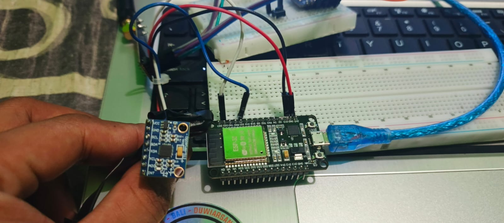
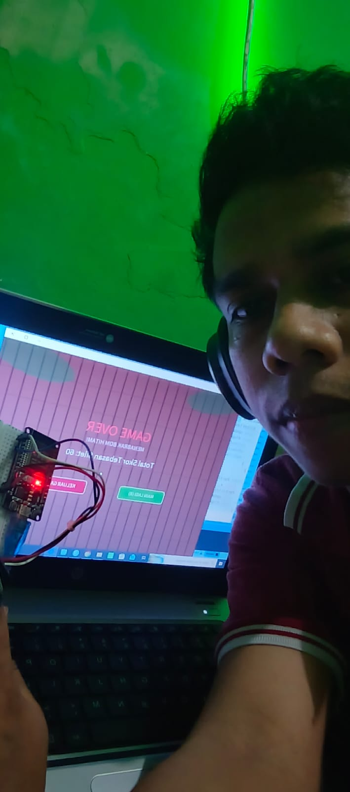

# Tilt Ball Game dengan Kontrol Gestur (ESP32 & MPU6050)

Proyek ini adalah permainan interaktif berbasis desktop (*Tilt Ball Game*) yang dikendalikan menggunakan gestur kemiringan tangan secara real-time. Proyek ini mengintegrasikan sensor **MPU6050** dan mikrokontroler **ESP32** sebagai kontroler fisik, serta **Processing 4** sebagai engine game di sisi komputer.

---

## 🚀 Fitur Utama
* **Kontrol Gestur Real-time:** Memanfaatkan sensor Gyroscope & Accelerometer (MPU6050) untuk membaca sudut kemiringan tangan (Roll & Pitch).
* **Koneksi Serial Cepat:** Pengiriman data dari ESP32 ke PC menggunakan komunikasi Serial UART yang responsif.
* **Visualisasi Game Interaktif:** Game bola bergerak dinamis di dalam arena berdasarkan hukum fisika sederhana yang dibuat dengan Processing 4.

---

## 🛠️ Komponen & Perangkat Keras
1. **ESP32 DevKit V1** (Mikrokontroler)
2. **MPU6050** (Sensor Akselerometer & Giroskop 6-axis)
3. **Kabel Jumper**
4. **Komputer/Laptop** (Untuk menjalankan Game Processing)

### Skema Pengkabelan (Wiring)

| ESP32 Pin | MPU6050 Pin | Keterangan |
|--- |--- |--- |
| **3V3 / VIN** | VCC | Daya |
| **GND** | GND | Ground |
| **GPIO 22** | SCL | I2C Clock |
| **GPIO 21** | SDA | I2C Data |

---

## 💻 Kebutuhan Perangkat Lunak
* **Arduino IDE** (Disarankan versi 2.x ke atas)
  * Library: `Adafruit MPU6050`, `Adafruit BusIO`, dan `Adafruit Unified Sensor`.
* **Processing 4** (Untuk menjalankan visualisasi game)
  * Library bawaan: `processing.serial.*`

---

## 📦 Struktur Repositori
* `Program Arduino IDE/` : Berisi kode program `.ino` untuk membaca sensor MPU6050 dan mengirim data serial lewat ESP32.
* `Program Processing 4/` : Berisi kode program `.pde` untuk membaca data serial komputer dan merender permainan bola.
* `Dokumentasi/` : Berisi file foto rangkaian komponen fisik perangkat keras dan tampilan visual game.

---

## 🛠️ Cara Menjalankan Proyek

### 1. Sisi Arduino (ESP32)
1. Buka file `.ino` di dalam folder `Program Arduino IDE` menggunakan Arduino IDE.
2. Pastikan Board **ESP32 Dev Module** dan **Port COM** yang sesuai sudah terpilih.
3. Instal library `Adafruit MPU6050` melalui Library Manager jika belum ada.
4. Lakukan **Compile & Upload** program ke ESP32 Anda.
5. Buka Serial Monitor (baud rate disesuaikan, misal `115200`) untuk memastikan data sudut/kemiringan sudah tercetak.

### 2. Sisi Processing 4
1. Tutup Serial Monitor di Arduino IDE (agar port serial tidak bentrok).
2. Buka file `.pde` di dalam folder `Program Processing 4` menggunakan Processing 4.
3. Sesuaikan nama port COM pada kode Processing agar cocok dengan port ESP32 Anda (misalnya `"COM3"`).
4. Klik tombol **Run** (ikon segitiga/Play) pada Processing 4.
5. Gerakkan sensor MPU6050 Anda untuk mengendalikan bola di dalam game!

---

## 📸 Dokumentasi & Demonstrasi Video

### Foto Perangkat & Jalannya Game
Berikut adalah dokumentasi rangkaian hardware dan demonstrasi gameplay:

| Rangkaian Alat 1 | Rangkaian Alat 2 | Tampilan Game / Dokumentasi |
|--- |--- |--- |
|  |  |  |

### 🎥 Link Video Demonstrasi
Anda dapat melihat video demonstrasi lengkap mengenai cara kerja alat dan cuplikan permainan melalui tautan di bawah ini:

🎬 **[Tonton Video Demonstrasi Tilt Ball Game](https://drive.google.com/file/d/1u3OfgG6Mr6HBlCE-szdWYF6XBBVZAUCi/view?usp=drivesdk)**
